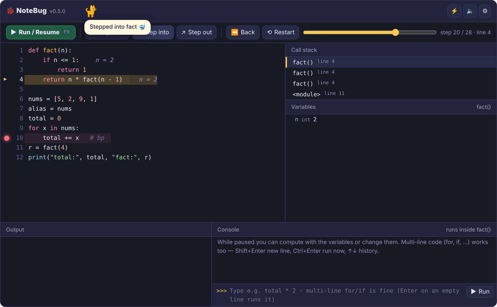
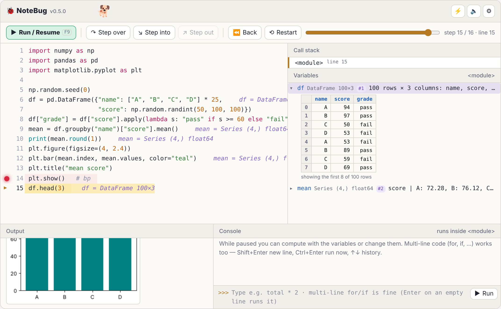
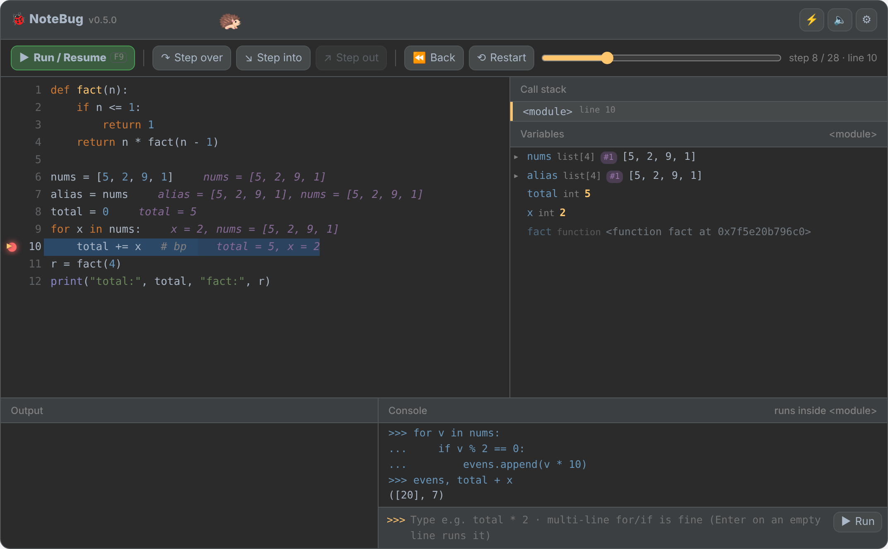

# 🐞 NoteBug

**A PyCharm-style breakpoint debugger that runs inside Google Colab and Jupyter — built for teaching Python.**

[](https://colab.research.google.com/github/aki5413/notebug/blob/main/examples/NoteBug_demo.ipynb)
[](https://github.com/aki5413/notebug/actions/workflows/tests.yml)
[](LICENSE)

[한국어](#한국어-빠른-시작) · [日本語](#日本語クイックスタート) · [日本語マニュアル（詳細）](docs/README_ja.md)

Beginners learn a lot by stopping a program and looking inside it, but notebook environments
have no friendly visual debugger. NoteBug adds one with a single line, `%%notebug`:
click a line number to set a breakpoint, step through the code, look at every variable,
and try out expressions in the paused frame — with a walking pet that narrates what happens.



## Features

- **Breakpoints** — click a line number, or write `# bp` / `breakpoint()` in the code
- **Stepping** — run / resume, step over, step into, step out, and **step back in time**
  (timeline slider)
- **Variables** — changed values in orange, new ones marked *new*, lists / dicts / objects
  expandable, `#id` badges that show when two names point to the same object,
  inline values next to the code, call stack with every frame's variables
- **Console** — run expressions or multi-line code (`for`, `if`, …) inside the paused frame (Colab)
- **Data analysis** — numpy / pandas / matplotlib aware: DataFrame table previews,
  shape and dtype labels, plots appear in the output panel at the step that drew them
- **Classroom friendly** — Korean / Japanese / English UI, four themes including a
  projector-friendly light theme, adjustable font size, a pet, power mode, sound, achievements
- **Shareable** — save any run as a standalone HTML page that opens in a browser without Python

| Data analysis (light theme) | Multi-line console (Darcula theme) |
|---|---|
|  |  |

## Install

In Colab or Jupyter:

```python
%pip install -q git+https://github.com/aki5413/notebug
import notebug
```

Or just open the [demo notebook in Colab](https://colab.research.google.com/github/aki5413/notebug/blob/main/examples/NoteBug_demo.ipynb)
and run the first cell.

## Use

```python
%%notebug --lang en --pet dog
total = 0
for i in range(1, 6):
    total += i      # bp
print(total)
```

| | |
|---|---|
| `%%notebug [options]` | debug a notebook cell |
| `notebug.config(lang="ko", theme="light", font_size=16)` | defaults for the whole notebook |
| `notebug.run(code)` | debug a string of code |
| `notebug.run_file("hw1.py")` | debug a `.py` file (e.g. a submitted assignment) |
| `notebug.save_html(code, "hw1.html")` | save a standalone page |
| `python -m notebug hw1.py -o hw1.html` | the same from a terminal |

Options: `--lang ko|ja|en`, `--theme night|light|darcula|contrast`, `--font 16`,
`--pet cat|dog|hedgehog|penguin|turtle|dino`, `--power`, `--sound`, `--max 3000`,
`--no-achievements`, `--no-export`. Details: [docs/README_ja.md](docs/README_ja.md).

Keys: **F9** run/resume · **F8 / ↓** step over · **F7 / →** step into · **Shift+F8 / ↑** step out · **←** back.

## How it works

The program is run once under `sys.settrace` and every step (line, variables, output, figures)
is recorded; the browser then replays the recording, so stepping backwards is instant.
Console input is sent to the kernel, which re-runs the program up to the selected step and
evaluates the input in that frame. `input()` answers and random states are recorded so the
re-run sees the same values.

**Limitations.** The console needs Google Colab (other environments show everything else).
Each console input re-runs the program up to that point, so heavy computations make it slower,
and code that depends on time, files or the network may behave differently on re-run.
Recording stops after `max_steps` steps (default 3000); the program still runs to the end.

## 한국어 빠른 시작

1. [Colab에서 데모 노트북 열기](https://colab.research.google.com/github/aki5413/notebug/blob/main/examples/NoteBug_demo.ipynb) → 첫 번째 셀 실행
2. 내 노트북에서 쓸 때는:
   ```python
   %pip install -q git+https://github.com/aki5413/notebug
   import notebug
   notebug.config(lang="ko")
   ```
3. 셀 맨 위에 `%%notebug` 를 쓰고 실행 → 줄 번호를 클릭해 브레이크포인트 → ▶

문제가 있으면 [Issues](https://github.com/aki5413/notebug/issues) 에 코드와 스크린샷을 올려 주세요.

## 日本語クイックスタート

1. [Colab でデモノートブックを開く](https://colab.research.google.com/github/aki5413/notebug/blob/main/examples/NoteBug_demo.ipynb) → 最初のセルを実行
2. 自分のノートブックでは:
   ```python
   %pip install -q git+https://github.com/aki5413/notebug
   import notebug
   notebug.config(lang="ja")
   ```
3. セルの先頭に `%%notebug` と書いて実行 → 行番号をクリックしてブレークポイント → ▶

詳しい使い方は [日本語マニュアル](docs/README_ja.md) を参照してください。

## Contributing, citing, license

- Bug reports and ideas: [Issues](https://github.com/aki5413/notebug/issues) · how to contribute: [CONTRIBUTING.md](CONTRIBUTING.md)
- If you use NoteBug in a course or a paper, please cite it — see [CITATION.cff](CITATION.cff)
  (GitHub shows a *Cite this repository* button).
- [MIT License](LICENSE)

Developed with the assistance of Claude (Anthropic); design decisions and classroom testing by the author.
